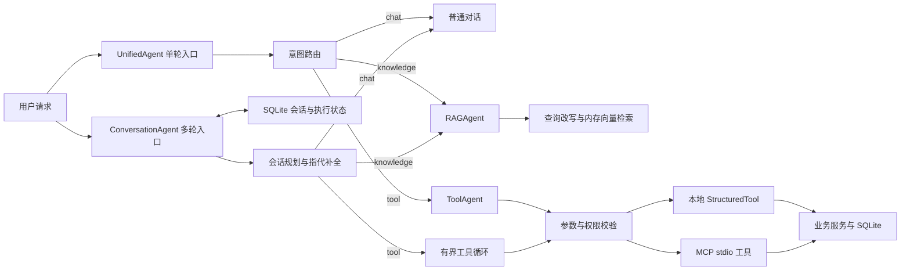

# Knowledge Agent Quality

面向企业内部知识查询场景的 Agent 应用与质量保障项目。基于 Python 和 LangChain 构建知识问答、工具调用与多轮会话，并使用 pytest、DeepEval 和 LLM-as-a-Judge 建立自动化测试与质量评测体系。

项目覆盖从意图路由、知识检索、回答生成到工具执行和会话状态的完整链路，结合回答内容、调用轨迹与数据库状态验证功能、可靠性和安全性。

## 核心能力

- **知识问答**：加载 Markdown 知识文档，递归切分并构建中文向量检索；结合查询改写、来源引用和信息不足时的拒答生成回答。
- **工具调用**：支持四则计算、年假查询和工单创建与查询，通过本地函数或 MCP 接入；结合可信身份进行工具选择、参数校验与资源授权。
- **多轮会话**：支持知识追问、信息补充、参数修改、未提交任务的取消和结果指代，保存会话历史与执行状态，处理会话隔离、重复请求和中断恢复。
- **异常容错**：对模型调用进行有限重试，将检索与工具异常转换为明确的降级结果，并根据执行回执说明业务处理状态。
- **测试评测**：覆盖检索、生成、引用、工具决策、多轮任务和 Agent 安全，分别评价模型行为与执行层防护。

## 项目架构



`UnifiedAgent` 负责单轮请求的路由与分支调度，`ConversationAgent` 结合会话历史规划每轮任务，复用知识问答及工具执行组件。工单和会话状态使用 SQLite 持久化；知识库使用 BGE Embedding 与 LangChain 内存向量存储。

## 技术栈

Python 3.11、LangChain、DeepSeek、HuggingFace Embedding、Pydantic、SQLite、MCP、pytest、DeepEval、Qwen Judge。

## 测试与评测

pytest 负责 fixture、参数化测试与自动化断言；项目通过适配层将采集到的回答、召回上下文、工具调用和会话记录转换为 DeepEval 评测对象，由框架执行内置指标及项目自定义指标。

- **单元测试**：隔离模型、检索器和工具依赖，验证路由解析、文档切分、指标计算、参数校验与异常边界。
- **集成测试**：覆盖本地业务组件、SQLite 状态、MCP Server/Client、stdio 通信及 LangChain 适配。
- **端到端评测**：使用模型执行路由、RAG、工具调用和多轮任务，验证回答、调用轨迹与业务结果。
- **质量门禁**：结合确定性规则、项目 Judge 和检索阈值判定结果；DeepEval 内置语义指标用于补充质量诊断。

| 评测范围 | 指标与检查内容 |
| --- | --- |
| 意图路由 | 路由准确率，以及普通对话、知识问答和工具请求的分支选择。 |
| 知识检索 | Recall@K、MRR、Evidence Recall@K，以及 DeepEval Contextual Precision / Contextual Recall。 |
| 回答与引用 | 项目 Judge 的正确性、完整性、忠实性、引用支持度；DeepEval Faithfulness / Answer Relevancy；拒答与引用有效性检查。 |
| 工具与业务 | 模型原始调用的名称、参数、次数和顺序；执行层权限防护、数据库状态、事务与幂等；DeepEval Tool Correctness。 |
| 多轮会话 | 补参、指代、未提交任务的修改与取消、依赖调用、会话隔离和恢复；DeepEval Conversation Completeness / Knowledge Retention。 |
| Agent 安全 | 直接与间接提示词注入、系统提示词提取、敏感信息提取和越权工具调用，结合内容规则、执行证据与安全 Judge 验证。 |

评测记录保留逐例分数、实际召回内容、模型工具提议、执行回执与调用轨迹，用于定位失败和回归验证。模型决策与工程防护分别统计；接口错误、未完成任务和质量不通过分别记录。

## 项目结构

```text
app/                 Agent、RAG、工具、业务、会话与评测实现
data/knowledge/      Markdown 企业知识库
data/evaluation/     检索、路由、工具、业务、多轮、安全与校准数据
tests/               单元、集成、端到端与质量门禁测试
scripts/             数据构建、结果核验与评测导出
.github/workflows/   离线测试与手动触发的模型评测工作流
pytest.ini           pytest Marker 配置
requirements.txt     Python 依赖
```

## 本地运行

在项目根目录创建 Python 3.11 虚拟环境并安装依赖：

```powershell
python -m venv .venv
.\.venv\Scripts\Activate.ps1
python -m pip install -r requirements.txt
```

在项目根目录创建 `.env`：

```dotenv
DEEPSEEK_API_KEY=your_api_key
QWEN_API_KEY=your_qwen_api_key
```

Agent 使用 DeepSeek；RAG Judge 与 DeepEval 语义指标使用千问 Plus，安全 Judge 使用千问 Max。仅体验 Agent 时只需配置 DeepSeek 密钥，运行语义评测还需配置千问密钥。

首次使用时下载 Embedding 模型并构建知识检索器，模型名称为 `BAAI/bge-small-zh-v1.5`。多轮 Demo 和评测采集器使用本地模型缓存，需先完成这一步：

```powershell
python -c "from app.agent_factory import build_knowledge_retriever; build_knowledge_retriever()"
```

单轮演示：

```powershell
python -m app.unified_agent_demo
```

多轮交互：

```powershell
python -m app.conversation_demo
```

可连续输入问题，使用 `/new` 新建会话、`/retry` 重试原轮次、`/status` 查看会话标识、`/exit` 退出。

通过 MCP 执行多轮工具任务：

```powershell
python -m app.conversation_demo --transport mcp
```

多轮 Demo 默认使用演示员工身份；可通过 `--user employee-e002` 或 `--user hr` 切换启动身份，通过 `--session` 指定同身份的已有会话。

## 执行测试与评测

快速离线回归：

```powershell
python -m pytest -m "not evaluation" -v
```

运行模型质量门禁：

```powershell
python -m pytest -m quality_gate -v --run-evaluation
```

默认测试不调用外部模型；模型评测需显式启用，并消耗 API Token。

DeepEval 评测先采集 Agent 的实际执行结果，再进行规则检查与语义评分：

```powershell
python -m app.deepeval_collect --run-models --max-calls 1000 --output reports/agent-sources
python -m app.deepeval_evaluation --sources reports/agent-sources/sources.json --mode all --run-models --max-calls 2000 --workers 4 --output reports/deepeval-scores
```

仅对已采集结果运行确定性指标：

```powershell
python -m app.deepeval_evaluation --sources reports/agent-sources/sources.json --mode rules --output reports/deepeval-rules
```

GitHub Actions 配置了离线测试与手动触发的模型评测；模型评测需配置相应 API 密钥。工作流见 [测试工作流](.github/workflows/quality.yml)。

完整参数可通过 `python -m app.deepeval_collect --help` 和 `python -m app.deepeval_evaluation --help` 查看。

## 适用范围

项目用于本地 Agent 开发、自动化测试和质量评测，知识库采用小规模 Markdown 文档与内存向量存储，MCP 采用本地 stdio 通信。身份由可信宿主配置提供，不包含生产登录和远程认证系统；评测结果对应具体数据集与模型配置，不代表生产环境的全面验证。
