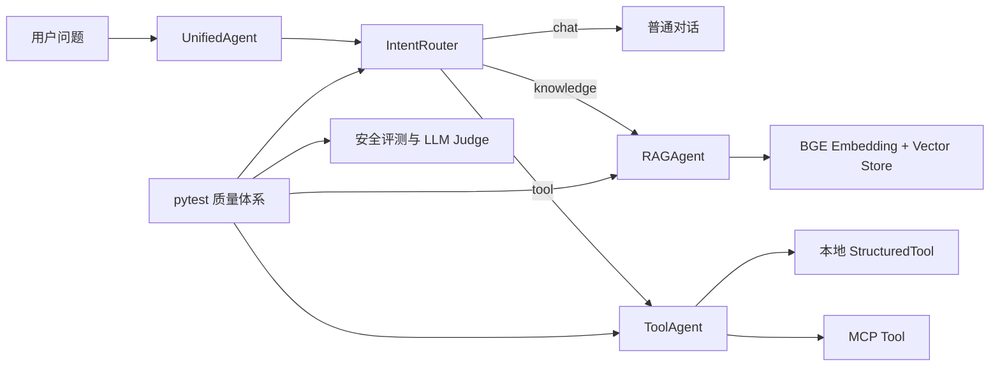

# Knowledge Agent Quality

面向企业知识助手 Agent 的质量保障实践项目。系统通过 `UnifiedAgent` 编排普通对话、RAG 知识问答和工具调用，并围绕检索质量、回答质量、异常降级、Agent 安全和 MCP 工具接入建立自动化测试与真实模型质量门禁。

## 项目架构



## 核心能力

- 意图路由：区分 `chat`、`knowledge` 和 `tool` 三类请求。
- RAG：Markdown 文档加载、递归切分、中文向量检索、查询改写、拒答和引用校验。
- Tool Calling：工具选择、参数校验、业务异常转换、权限拦截和双轮消息编排。
- 稳定性：模型有限重试、指数退避、检索异常转换和分阶段降级。
- 质量评测：Recall@K、MRR、Evidence Recall@K、确定性规则和 LLM-as-a-Judge。
- 安全测试：直接/间接 Prompt Injection、系统提示词泄露、敏感信息泄露和越权工具调用。
- MCP：基于 MCP 2.1 和 stdio 的工具发现、调用、LangChain 适配与异常测试。

## 技术栈

Python 3.11、pytest、LangChain、DeepSeek、HuggingFace Embedding、Pydantic、MCP 2.1

## 测试分层

- 单元测试：使用 Fake 隔离模型、检索器和工具，验证确定性逻辑与异常边界。
- 集成测试：组合真实本地组件，覆盖 MCP Server、Client、stdio 和 LangChain 适配。
- 端到端评测：使用真实模型验证路由、RAG、Tool Calling 和 UnifiedAgent 完整链路。
- 质量门禁：在检索、回答和安全数据集上执行阈值检查。

当前已记录结果：

- 非真实模型回归：`226 passed`，`22 deselected`
- MCP 离线专项：`18 passed`
- MCP 真实模型门禁：`2 passed`
- 安全核心基线：`8/8 passed`
- 检索基线：Recall@5、MRR、Evidence Recall@5 均为 `0.8889`

## 项目结构

```text
app/                 Agent、RAG、评测、安全与 MCP 实现
data/knowledge/      Markdown 企业知识库
data/evaluation/     检索、路由与安全 JSONL 用例
tests/               单元、集成、端到端与质量门禁测试
pytest.ini           pytest Marker 配置
requirements.txt     Python 依赖
```

## 本地运行

安装依赖：

```powershell
python -m pip install -r requirements.txt
```

在项目根目录创建 `.env`：

```dotenv
DEEPSEEK_API_KEY=your_api_key
```

运行 UnifiedAgent Demo：

```powershell
python -m app.unified_agent_demo
```

运行 MCP 完整 Demo：

```powershell
python -m app.mcp_unified_agent_demo
```

## 执行测试

快速离线回归：

```powershell
python -m pytest -m "not evaluation" -v
```

运行真实模型质量门禁：

```powershell
python -m pytest -m quality_gate -v --run-evaluation
```

真实模型评测会消耗 API Token，并受到模型服务和输出波动影响；默认测试不会主动运行这些用例。

## 当前边界

本项目是个人学习项目，目前使用小规模本地知识库和内存向量存储。MCP 仅覆盖本地 stdio，尚未实现远程传输、认证、多服务聚合、性能压测和生产级可观测性。
